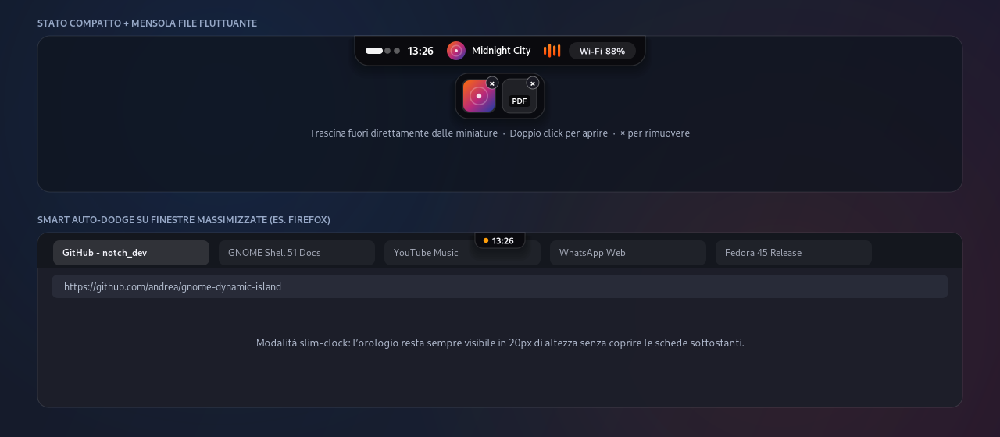
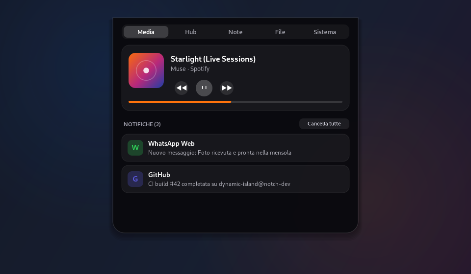
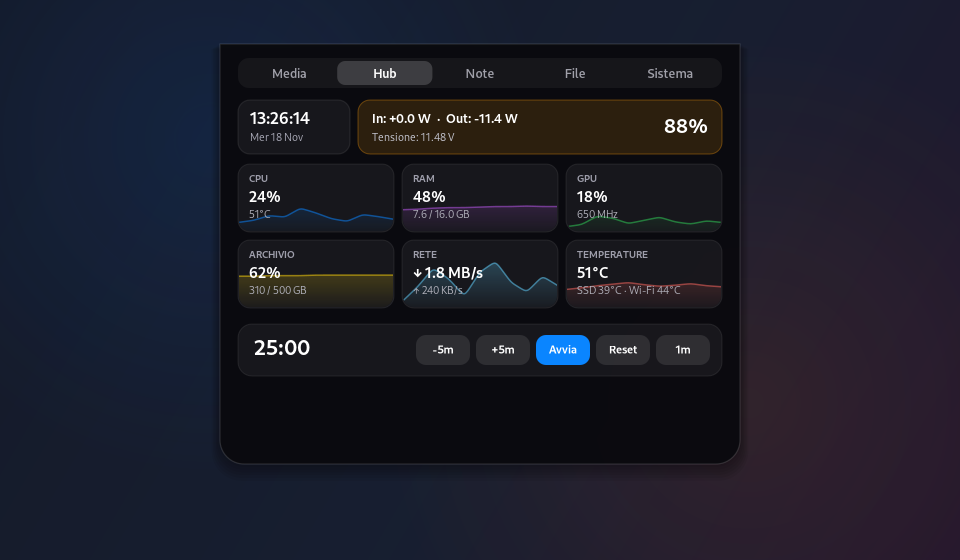
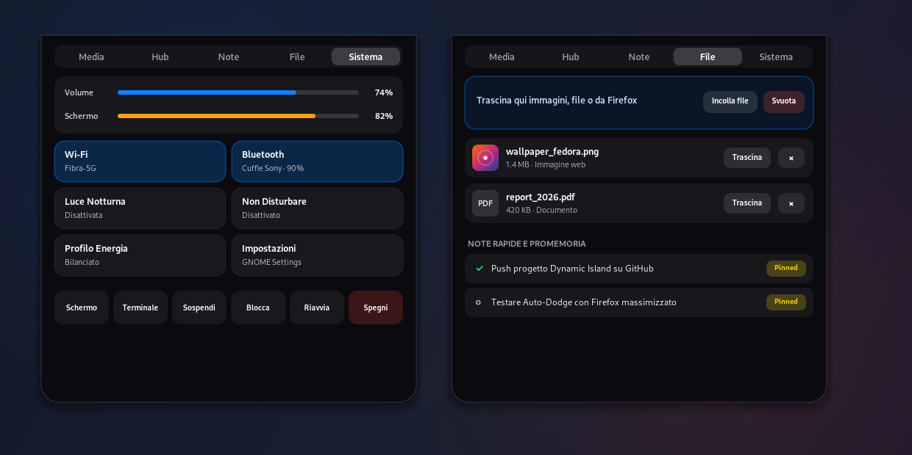

# GNOME Dynamic Island e Pill

Un'estensione per **GNOME Shell 50 e 51 (Wayland)** che sostituisce o integra la barra superiore con una Dynamic Island interattiva stile macOS / iOS, dotata di controlli multimediali MPRIS, telemetria di sistema con grafici in tempo reale, timer Pomodoro con segnale sonoro, note rapide, mensola file drag-and-drop bidirezionale e controlli rapidi di sistema.



## Funzionalità principali

### 1. Stato compatto e Smart Auto-Dodge
- **Sostituzione opzionale della Top Bar**: nasconde la barra classica di GNOME mantenendo orologio, indicatori degli spazi di lavoro (scroll con rotellina e click per Attività), stato Wi-Fi, volume e percentuale batteria.
- **Smart Auto-Dodge (`slim-clock` / `peek-bar`)**: rileva automaticamente le finestre massimizzate o che coprono la fascia superiore (come Firefox o Chrome) e riduce l'isola a una pillola ultra-compatta con il solo orologio (`~18–20px`) o a una micro-linguetta sul bordo superiore, lasciando libere e cliccabili le schede sottostanti.
- **Persistenza in fullscreen**: disabilita l'unredirect del compositor in modo che l'isola resti accessibile anche sopra app a schermo intero.
- **Apertura configurabile**: espansione al passaggio del mouse, al click oppure entrambi, con scelta nelle preferenze tra apertura su una schermata fissa o memoria dell'ultima scheda aperta.

### 2. Media, Equalizzatore e Notifiche


- **Controlli MPRIS2 e Seek nel brano**: supporto a Spotify, browser (YouTube, web player) e riproduttori locali con copertina album (scaricata in cache locale se remota), titolo, artista, sorgente, tasti transport (`Precedente`, `Play/Pausa`, `Successivo`) e barra di avanzamento interattiva con minuti trascorsi/totali (`SetPosition` / `Seek`).
- **Audio Visualizer Cairo**: sei stili configurabili (`bars`, `spectrum`, `segments`, `solid`, `wave`, `ribbon`) con aggiornamento in-place a zero allocazioni per frame.
- **Centro notifiche integrato**: elenco scorrevole delle notifiche recenti con soppressione opzionale del popup nativo di GNOME e pulsante `Cancella tutte`.
- **OSD e avvisi configurabili (`inside` / `below`)**: intercetta Volume, Mute, Luminosità, stato Batteria/alimentatore, connessioni Bluetooth, Timer completato e registrazione schermo; Notifiche, Timer e Bluetooth possono apparire dentro la notch oppure sotto di essa in una pillola dedicata con animazione di comparsa.

### 3. Hub Telemetria e Timer Pomodoro


- **Monitoraggio asincrono in tempo reale**: letture parallele non bloccanti su `/proc` e `sysfs` per `CPU`, `RAM`, `GPU`, `ARCHIVIO`, `RETE` (RX/TX) e `TEMPERATURE` (CPU, SSD NVMe, Wi-Fi), con mini grafici ad area traslucidi sugli ultimi 18 campioni dietro alle metriche.
- **Alimentazione e batteria dettagliate**: lettura separata potenza in ingresso/uscita (`In: +W · Out: -W`), tensione (`V`) e indicatore percentuale ad alta leggibilità.
- **Timer Pomodoro / Conto alla rovescia**: controlli rapidi (`-5m`, `+5m`, `Avvia/Pausa`, `Reset`, `1m`), badge compatto mentre il timer è attivo e segnale sonoro di fine timer tramite `Meta.SoundPlayer` (configurabile).

### 4. Mensola File Drag-and-Drop, Note Rapide e Controlli Sistema


- **Mensola File bidirezionale (GTK4 Wayland helper)**:
  - Trascinando file o immagini sopra la notch l'area si espande automaticamente per ricevere il drop.
  - Supporta file locali dal file manager, dati binari da browser (`image/png`, `jpeg`, `webp`, `gif`, `avif`, `svg`), URL diretti, URI `data:image/...;base64,...` e l'estrazione delle immagini reali da `text/html` e link di Google Immagini (`imgurl=`).
  - Quando chiusa, mostra le miniature compatte direttamente sotto la notch (anche durante le notifiche) con drag-out diretto verso altre app, apertura con doppio click o click destro e rimozione tramite `×`.
- **Note Rapide e Scratchpad**: checklist persistente su `GSettings` con possibilità di fissare una nota in primo piano nella pillola compatta (`pin`), più blocco note multi-riga.
- **Scheda Sistema**: slider interattivi Volume e Luminosità, griglia Quick Settings 2x3 con pulsanti split Wi-Fi (connessione/disconnessione reti e supporto WPA3) e Bluetooth (toggle con sincronizzazione `Rfkill` e connessione/disconnessione dispositivi associati) e 6 azioni rapide (Screenshot, Terminale, Sospendi, Blocca, Riavvia, Spegni).

---

## Requisiti

- **GNOME Shell**: `50` o `51` (testata su Fedora Linux Workstation con sessione Wayland).
- **Dipendenze di sistema**:
  - `gjs` (GTK 4.0, `GdkPixbuf`, `Soup 3.0`, `Libadwaita`)
  - `glib-compile-schemas` (`glib2`)
  - Opzionali: `wl-clipboard` (`wl-copy` / `wl-paste`) per i pulsanti copia/incolla file nella Mensola File.

---

## Installazione

### Da sorgente (installatore locale con hot-reload)

```bash
git clone https://github.com/andrea/gnome-dynamic-island.git
cd gnome-dynamic-island
./install.sh
```

Lo script compila gli schemi `GSettings`, copia i file in `~/.local/share/gnome-shell/extensions/dynamic-island@notch-dev` ed esegue il riavvio a caldo dell'estensione tramite `gnome-extensions`.

### Creazione pacchetto `.shell-extension.zip`

```bash
make pack
gnome-extensions install --force dynamic-island@notch-dev.shell-extension.zip
```

### Disinstallazione

```bash
make uninstall
```

---

## Configurazione

Tutte le impostazioni sono modificabili live dalla finestra Libadwaita dedicata tramite **Gestore estensioni** (*Extension Manager*) oppure da terminale:

```bash
./open-prefs.sh
```

Principali categorie configurabili:
- **Stile e Posizione**: `position` (`notch-top`, `top-center`, `panel-center`, `panel-notch`, `panel-left`, `panel-right`, `bottom-center`), `idle-mode`, `auto-dodge` (`slim-clock`, `peek-bar`, `off`), `toast-position` (`inside`, `below`), `always-open-default-tab`, `default-tab`, `expand-on`, `animation-style`, `hide-top-bar`, `show-compact-status`, dimensioni e margini.
- **Aspetto Media**: dimensione e forma copertina, bordo, rotazione vinile, stile equalizer e colore accento.
- **Moduli attivi**: toggle indipendenti per Media MPRIS, OSD Volume/Luminosità, Batteria, Bluetooth, Notifiche e soppressione banner GNOME, Workspaces, Registrazione schermo, Progresso file, Statistiche Hub e Suono fine timer.

---

## Struttura del repository

```text
gnome-dynamic-island/
├── extension.js                 # Entry point ESM con caricamento moduli e disable sincrono
├── island.js                    # UI Clutter/St della notch, animazioni morph e logica delle 5 schede
├── prefs.js                     # Finestra preferenze GTK4 / Libadwaita collegata a GSettings
├── stylesheet.css               # Tema visivo della Dynamic Island
├── metadata.json                # Metadati GNOME Shell 50 / 51 (UUID: dynamic-island@notch-dev)
├── install.sh                   # Compilazione schemi, installazione locale e reload
├── open-prefs.sh                # Apertura rapida delle preferenze anche in modalità standalone
├── Makefile                     # Target: compile, install, uninstall, pack, check
├── schemas/
│   └── org.gnome.shell.extensions.dynamic-island-notch.gschema.xml
├── sources/
│   ├── battery.js               # Monitor alimentazione e carica batteria
│   ├── bluetooth.js             # Notifiche connessione dispositivi Bluetooth
│   ├── fileShelf.js             # Bridge Wayland verso l'helper GTK4 della mensola file
│   ├── media.js                 # Watcher player MPRIS2 via D-Bus
│   ├── notifications.js         # Intercettazione notifiche GNOME e soppressione banner
│   ├── osd.js                   # Intercettazione OSD Volume e Luminosità
│   ├── progress.js              # Monitoraggio avanzamento operazioni/download
│   ├── recording.js             # Indicatore registrazione schermo
│   ├── systemControls.js        # Backend Quick Settings (Volume, Brightness, NM Wi-Fi, BlueZ, UPower)
│   └── systemStats.js           # Campionatore asincrono /proc e sysfs per l'Hub
├── tools/
│   └── drop-catcher.js          # Helper GTK4 (Meta.WaylandClient) per drag-in/out e download immagini web
└── assets/
    └── screenshots/             # Immagini dimostrative usate in questo README
```

---

## Licenza

Distribuito sotto licenza **GNU General Public License v3.0 (GPL-3.0)** — vedi il file [LICENSE](LICENSE).
